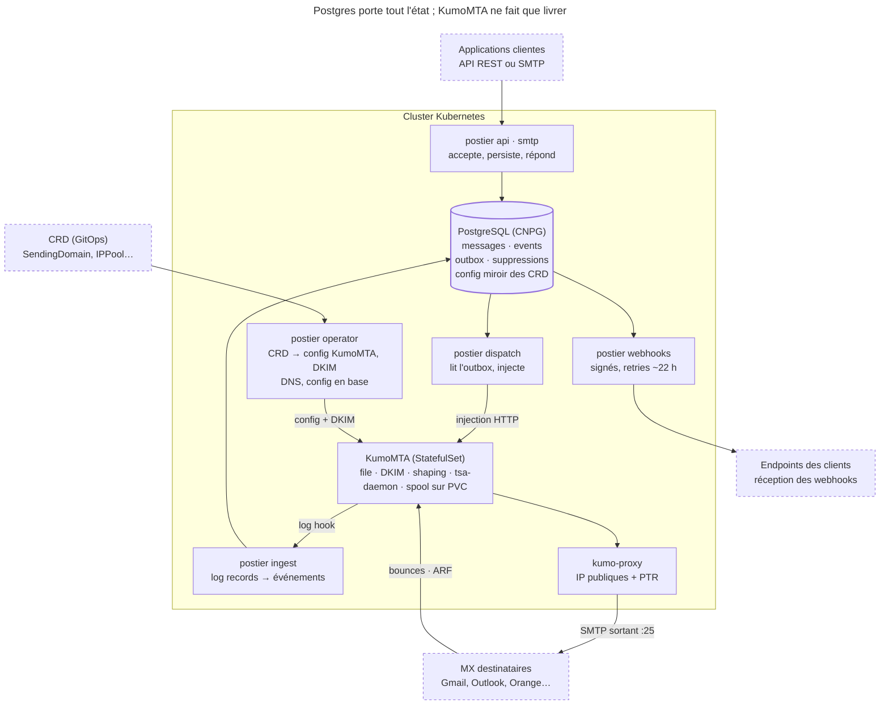
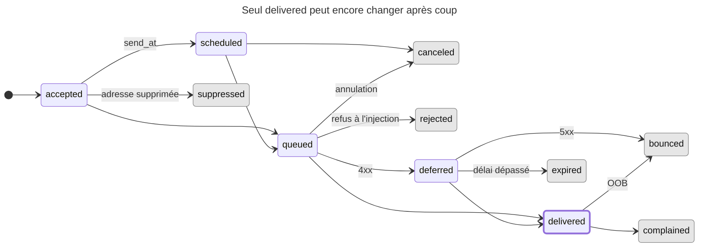
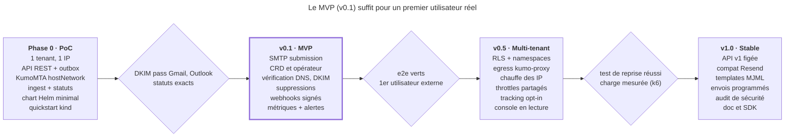

# Architecture — plateforme d'email transactionnel native Kubernetes

Nov 13, 2026 · @Nawer

## Vision et périmètre

**Postier** (nom de travail) est une plateforme d'email transactionnel auto-hébergée, configurée par CRD, qui confie la livraison SMTP à KumoMTA et apporte ce qui lui manque : API, état par message, suppressions, webhooks et opérateur Kubernetes.

### Principes de conception

- **Kubernetes d'abord** : toute la configuration d'infrastructure (domaines, IP, shaping, webhooks) est déclarative en CRD et compatible GitOps. Aucune action obligatoire dans une UI.
- **Ne pas réécrire un MTA** : KumoMTA (Rust, Apache-2.0) fait la file, le DKIM, le traffic shaping et la livraison. Postier orchestre autour.
- **Plan de données sans état** : seul Postgres porte l'état métier. Le spool KumoMTA est un état transitoire, jamais la source de vérité.
- **Accepté = persisté** : un `202` API ou un `250` SMTP n'est renvoyé qu'après commit en base (outbox transactionnelle).
- **Événements d'abord** : chaque changement d'état est un événement append-only ; le statut d'un message est une projection de ses événements.
- **Multi-tenant dès le modèle de données**, même si la v0 ne sert qu'un tenant.
- **Un binaire, plusieurs rôles** : une seule image Go, des sous-commandes (`postier api`, `postier smtp`, `postier ingest`…), comme Postal.

### Non-objectifs

- Pas de campagnes, newsletters ni gestion de listes de contacts (listmonk et Keila le font).
- Pas de boîtes mail, IMAP ou réception généraliste : l'entrant se limite aux bounces et aux feedback loops.
- Pas d'éditeur visuel de templates en v1 : templates en code (MJML ou HTML + variables).
- Pas de dépendance à un fournisseur d'envoi (SES, Mailgun). Un relais upstream optionnel pourra venir plus tard.

## Vue d'ensemble



Le chemin d'envoi descend à gauche (API, outbox, injection, livraison) et le chemin des événements remonte à droite (log hook, ingestion, webhooks). Tout passe par Postgres, au centre. Les cadres en pointillés sont hors du cluster.

## Composants du plan de données

Le plan de données compte sept rôles Postier sans état, plus KumoMTA, seul composant avec un volume persistant.

| Composant | Rôle | Workload | Mise à l'échelle | État |
| --- | --- | --- | --- | --- |
| `postier api` | API REST, auth, validation, rendu des templates, idempotence, écriture message + outbox | Deployment ≥ 2 | HPA sur CPU et requêtes/s | aucun |
| `postier smtp` | Submission 587 (STARTTLS) et 465 (TLS implicite), AUTH par credential projet | Deployment ≥ 2 | HPA sur connexions | aucun |
| `postier dispatch` | Lit l'outbox et injecte dans KumoMTA via son API HTTP d'injection | Deployment ≥ 2 | replicas libres (`SKIP LOCKED`) | aucun |
| KumoMTA | File, signature DKIM, shaping, livraison SMTP, bounces asynchrones, ARF | StatefulSet | ajout de nœuds, drain avant retrait | spool sur PVC |
| `tsa-daemon` | Suspensions et ralentissements automatiques selon les réponses des MX | Deployment 1 | — | léger |
| `postier ingest` | Reçoit les log records KumoMTA, écrit les événements, met à jour l'état, alimente suppressions et webhooks | Deployment ≥ 2 | HPA sur lag | aucun |
| `postier webhooks` | Livre les webhooks signés avec retries | Deployment ≥ 2 | replicas libres | aucun |
| `postier tracking` | Pixel d'ouverture et redirection de clics, désactivé par défaut | Deployment ≥ 2 | HPA | aucun |
| `postier operator` | Réconcilie les CRD, génère la config KumoMTA, vérifie le DNS | Deployment 2 (leader election) | — | aucun |

### Chemin d'un message

1. Le client appelle l'API ou se connecte en SMTP. Postier vérifie la credential, le quota, la liste de suppression et la propriété du domaine expéditeur.
2. Dans une seule transaction, Postier écrit une ligne `messages` par destinataire, l'événement `accepted` et une ligne d'outbox. Puis il répond `202` ou `250`.
3. `dispatch` prend les lignes d'outbox (`FOR UPDATE SKIP LOCKED`), injecte dans KumoMTA avec l'identifiant Postier en métadonnée, puis supprime la ligne d'outbox.
4. KumoMTA signe en DKIM, met en file par domaine destinataire et livre selon le shaping et le pool d'IP du tenant.
5. Chaque étape produit un log record JSON. Un log hook webhook de KumoMTA les envoie par lots à `ingest`. Ces envois passent par une file interne et durable de KumoMTA, donc ils survivent à une indisponibilité d'`ingest`.
6. `ingest` traduit en événement Postier, applique la transition d'état, met à jour les suppressions et crée les livraisons de webhooks.

### Choix structurants

- **Outbox plutôt qu'injection directe** : si KumoMTA est indisponible ou en drain, l'API continue d'accepter. Les messages attendent en base, sans perte.
- **Un destinataire = un message** : un envoi à 3 destinataires crée 3 messages avec 3 identifiants. L'état est toujours suivi par destinataire, comme chez les fournisseurs du marché.
- **Return-Path VERP** : l'adresse de retour encode l'identifiant (`b+<id>@bounce.<domaine>`). Un bounce asynchrone reçu des heures plus tard se rattache sans ambiguïté au bon message.
- **Pas de broker obligatoire** : le log hook HTTP de KumoMTA suffit jusqu'à un volume élevé. Kafka reste une option, car KumoMTA sait y publier ses logs nativement.

## Plan de contrôle : opérateur et CRD

L'opérateur porte la configuration déclarative : sept CRD décrivent l'infrastructure d'envoi, et l'opérateur les traduit en configuration KumoMTA, en enregistrements DNS et en lignes de configuration dans Postgres. Les données dynamiques (messages, suppressions, événements) restent en base et passent par l'API, jamais par etcd.

Groupe API provisoire : `postier.dev/v1alpha1`.

| CRD | Portée | Qui l'écrit | Ce qu'elle décrit |
| --- | --- | --- | --- |
| `PostierCluster` | cluster | admin plateforme | installation : Postgres, replicas KumoMTA, stockage, hostname EHLO, fonctionnalités actives |
| `IPPool` | cluster | admin plateforme | IP sources, hostname EHLO/PTR de chaque IP, mode d'egress, plan de chauffe |
| `TrafficShapingPolicy` | cluster | admin plateforme | règles par fournisseur destinataire (connexions, débit, réactions aux codes SMTP) |
| `Tenant` | cluster | admin plateforme | namespace associé, quotas, pools d'IP autorisés, rétention |
| `SendingDomain` | namespace du tenant | tenant | domaine, DKIM, sous-domaines return-path et tracking, mode DNS |
| `WebhookEndpoint` | namespace du tenant | tenant | URL, types d'événements, secret de signature |
| `ApiCredential` | namespace du tenant | tenant | clé API ou identifiant SMTP, portées, CIDR autorisés |

### Exemple : `SendingDomain`

```yaml
apiVersion: postier.dev/v1alpha1
kind: SendingDomain
metadata:
  name: notifications-acme
  namespace: tenant-acme
spec:
  domain: notifications.acme.fr
  ipPool: shared-fr
  dkim:
    selector: pst1
    algorithm: rsa-2048        # ou ed25519 en double signature
    rotationDays: 180
  returnPath:
    subdomain: bounce          # bounce.notifications.acme.fr (MX vers KumoMTA)
  tracking:
    enabled: false
  dns:
    mode: external-dns         # ou manual
status:
  conditions:
    - type: OwnershipVerified
      status: "True"
    - type: DKIMPublished
      status: "True"
    - type: SPFValid
      status: "False"
      reason: IncludeMissing
    - type: Ready
      status: "False"
  requiredRecords:
    - { type: TXT, name: _postier-challenge.notifications.acme.fr, value: "pst-verify=…" }
    - { type: TXT, name: pst1._domainkey.notifications.acme.fr, value: "v=DKIM1; k=rsa; p=…" }
    - { type: MX,  name: bounce.notifications.acme.fr, value: "10 mx.postier.example." }
    - { type: TXT, name: notifications.acme.fr, value: "v=spf1 include:spf.postier.example ~all" }
```

### Exemple : `IPPool`

```yaml
apiVersion: postier.dev/v1alpha1
kind: IPPool
metadata:
  name: shared-fr
spec:
  egress:
    mode: proxy                # hostNetwork | proxy
    proxyRef: kumo-proxy-edge
  sources:
    - address: 203.0.113.10
      ehlo: mta1.postier.example
    - address: 203.0.113.11
      ehlo: mta2.postier.example
  warmup:
    planRef: default-30-days
status:
  sources:
    - address: 203.0.113.10
      ptrMatches: true
      blocklisted: []
      warmupDay: 12
```

### Boucles de réconciliation

1. **Rendu KumoMTA** : `IPPool`, `TrafficShapingPolicy`, `SendingDomain` et `Tenant` produisent les fichiers de données lus par la politique Lua (sources, queues, DKIM, shaping) dans un ConfigMap. La clé DKIM privée est montée depuis un Secret. KumoMTA recharge sa configuration quand ces fichiers changent ; sinon, l'opérateur déclenche un rolling restart (comportement exact à valider sur la version visée).
2. **DKIM** : l'opérateur génère la paire de clés dans un Secret. En mode `external-dns`, il crée un `DNSEndpoint` portant le TXT. La rotation publie le nouveau sélecteur, attend sa propagation, bascule la signature, puis retire l'ancien sélecteur après 7 jours.
3. **Vérification DNS** : résolution périodique (toutes les 10 min, puis toutes les 6 h une fois `Ready`) de chaque enregistrement attendu, écrite dans les `conditions`. Un domaine non vérifié ne peut pas envoyer.
4. **Santé des IP** : PTR et FCrDNS vérifiés, interrogation des DNSBL principales, jour de chauffe exposé en statut.
5. **Credentials** : un `ApiCredential` produit une clé aléatoire. Son hash va en base, la valeur en clair va dans un Secret du namespace, sur le modèle de cert-manager. Les pods du tenant la montent directement.
6. **Synchronisation base** : chaque CRD a sa ligne miroir dans Postgres, lue par le plan de données. Les rôles Postier ne parlent jamais à l'API Kubernetes, ce qui simplifie leur RBAC et leurs tests.

La validation se fait en CEL dans les CRD (formats, bornes). Un webhook d'admission couvre ce que CEL ne peut pas vérifier : unicité d'un domaine entre tenants et appartenance du pool d'IP aux pools autorisés du tenant.

## Modèle de données et états des messages

Postgres est l'unique source de vérité. Les tables volumineuses (`messages`, `events`) sont partitionnées par mois : la rétention consiste à détacher une partition, pas à lancer un `DELETE` massif.

### Schéma principal

```sql
-- Identifiants : UUIDv7 (triables dans le temps, bons pour les index B-tree)
CREATE TABLE messages (
  id              uuid        NOT NULL,
  tenant_id       uuid        NOT NULL,
  project_id      uuid        NOT NULL,
  batch_id        uuid,                       -- envoi d'origine (plusieurs destinataires)
  source          text        NOT NULL,       -- 'api' | 'smtp'
  from_addr       text        NOT NULL,
  rcpt_addr       text        NOT NULL,
  rcpt_domain     text        NOT NULL,
  subject         text,
  status          text        NOT NULL,       -- voir machine à états
  status_at       timestamptz NOT NULL,
  attempts        int         NOT NULL DEFAULT 0,
  send_at         timestamptz,                -- envoi programmé
  tags            text[]      NOT NULL DEFAULT '{}',
  metadata        jsonb       NOT NULL DEFAULT '{}',
  ip_pool         text,
  size_bytes      int,
  created_at      timestamptz NOT NULL DEFAULT now(),
  PRIMARY KEY (id, created_at)
) PARTITION BY RANGE (created_at);

CREATE TABLE events (
  id              uuid        NOT NULL,
  message_id      uuid        NOT NULL,
  tenant_id       uuid        NOT NULL,
  type            text        NOT NULL,       -- accepted, queued, delivered, deferred…
  occurred_at     timestamptz NOT NULL,
  dedup_key       text        NOT NULL,       -- dérivé du log record KumoMTA
  smtp_code       int,
  enhanced_code   text,                       -- ex. 5.1.1
  bounce_class    text,                       -- classification KumoMTA
  remote_mx       text,
  source_ip       inet,
  detail          jsonb       NOT NULL DEFAULT '{}',
  PRIMARY KEY (id, occurred_at),
  UNIQUE (dedup_key, occurred_at)
) PARTITION BY RANGE (occurred_at);

CREATE TABLE outbox_injection (message_id uuid PRIMARY KEY, available_at timestamptz, attempts int);
CREATE TABLE suppressions (tenant_id uuid, project_id uuid, addr_hash bytea, addr text,
                           reason text, expires_at timestamptz, created_at timestamptz,
                           PRIMARY KEY (project_id, addr_hash));
CREATE TABLE idempotency_keys (project_id uuid, key text, request_hash bytea,
                               response jsonb, expires_at timestamptz,
                               PRIMARY KEY (project_id, key));
CREATE TABLE webhook_deliveries (id uuid PRIMARY KEY, endpoint_id uuid, event_id uuid,
                                 attempt int, next_at timestamptz, last_status int);
```

Tables de configuration (miroirs des CRD) : `tenants`, `projects`, `api_credentials` (préfixe + hash SHA-256), `sending_domains`, `ip_pools`, `webhook_endpoints`. Index clés : `(project_id, created_at DESC)`, `(project_id, rcpt_addr, created_at DESC)` pour la recherche par destinataire, et un GIN sur `tags`.

### États d'un message

Un message a un statut courant et un historique d'événements. Les états terminaux sont `delivered`, `bounced`, `expired`, `suppressed`, `rejected` et `canceled`. Deux transitions restent possibles après `delivered` : un bounce asynchrone (`bounced`) et une plainte (`complained`). Ouvertures et clics sont des événements qui ne modifient pas le statut.



Fond grisé : état terminal. Bordure épaisse (`delivered`) : terminal, mais un bounce asynchrone ou une plainte restent possibles.

Un bounce en session (5xx) peut aussi arriver directement depuis `queued`, sans passer par `deferred`.

| Log record KumoMTA | Événement Postier | Statut résultant |
| --- | --- | --- |
| `Reception` (injection acceptée) | `queued` | `queued` |
| `TransientFailure` | `deferred` | `deferred` |
| `Delivery` | `delivered` | `delivered` |
| `Bounce` (rejet en session SMTP) | `bounced` | `bounced` |
| `OOB` (bounce asynchrone) | `bounced` | `bounced`, y compris après `delivered` |
| `Feedback` (rapport ARF) | `complained` | `complained` |
| `Expiration` | `expired` | `expired` |
| `AdminBounce` | `canceled` | `canceled` |
| `Rejection` | `rejected` | `rejected` |

Règle de préséance : `ingest` n'applique jamais une régression. Un `deferred` qui arrive après un `delivered` (ordre de livraison des logs non garanti) est enregistré comme événement, mais ne change pas le statut. La transition se fait par un `UPDATE … WHERE status = ANY(<états autorisés>)`, sans verrou applicatif.

## API publique : REST et SMTP

L'API REST est définie d'abord en OpenAPI 3.1. Le serveur et les SDK en sont générés. SMTP et REST mènent au même pipeline interne et produisent les mêmes identifiants et événements.

### Endpoints v1

| Méthode | Chemin | Usage |
| --- | --- | --- |
| `POST` | `/v1/emails` | envoyer un email (1 à 50 destinataires) |
| `POST` | `/v1/emails/batch` | jusqu'à 100 emails différents en un appel |
| `GET` | `/v1/emails/{id}` | statut courant d'un message |
| `GET` | `/v1/emails?status=&to=&tag=&since=&cursor=` | recherche paginée par curseur |
| `GET` | `/v1/emails/{id}/events` | historique complet d'un message |
| `POST` | `/v1/emails/{id}/cancel` | annuler un envoi programmé non parti |
| `GET` | `/v1/events?cursor=` | flux d'événements à consommer en pull, alternative aux webhooks |
| `GET` `POST` `DELETE` | `/v1/suppressions` | consulter, ajouter, retirer une suppression |
| `DELETE` | `/v1/recipients/{address}` | droit à l'effacement : purge les données d'un destinataire |
| `GET` | `/v1/domains` | domaines du projet et leur statut DNS (lecture seule, reflète le CRD) |
| `GET` | `/v1/stats?granularity=hour` | compteurs agrégés par statut et par tag |

### Exemple d'envoi

```http
POST /v1/emails HTTP/1.1
Authorization: Bearer pst_live_7Hq2_…
Idempotency-Key: order-48213-confirmation
Content-Type: application/json

{
  "from": "Acme <no-reply@notifications.acme.fr>",
  "to": ["client@example.org"],
  "subject": "Votre commande 48213",
  "template": { "id": "order-confirmation", "data": { "order": "48213" } },
  "tags": ["order", "confirmation"],
  "metadata": { "order_id": "48213" },
  "send_at": null
}
```

```json
HTTP/1.1 202 Accepted
{
  "batch_id": "0193a1c2-…",
  "messages": [
    { "id": "0193a1c2-7e4f-…", "to": "client@example.org", "status": "accepted" }
  ]
}
```

### Règles transverses

- **Authentification** : `Bearer pst_<env>_<préfixe>_<secret>`. Le préfixe sert à la recherche en base. Le secret de 32 octets aléatoires est comparé à son hash SHA-256 (suffisant pour une clé à forte entropie). Portées : `send`, `read`, `suppressions`, `admin`.
- **Idempotence** : l'en-tête `Idempotency-Key` est conservé 24 h. Même clé et même corps : la réponse d'origine est rejouée. Même clé et corps différent : `409`.
- **Limites** : quota journalier par tenant tenu en base, et débit par seconde approché par pod (quota du tenant divisé par le nombre de replicas). On évite ainsi Redis sur le chemin d'envoi. En-têtes `RateLimit-*` standard, `429` avec `Retry-After`.
- **Erreurs** : format RFC 9457 (`application/problem+json`), avec un `code` stable (`domain_not_verified`, `recipient_suppressed`, `quota_exceeded`…).
- **Destinataire supprimé** : l'appel réussit et le message passe directement à `suppressed`. Le client voit pourquoi rien n'est parti, sans gérer d'erreur.
- **Couche de compatibilité** (v1.0) : un préfixe `/compat/resend/` qui accepte le format des fournisseurs les plus courants, pour migrer en changeant seulement l'URL de base.

### SMTP

- Ports 587 (STARTTLS obligatoire avant AUTH) et 465 (TLS implicite). AUTH PLAIN et LOGIN. Identifiant = ID de la credential, mot de passe = secret.
- En-têtes de contrôle retirés avant envoi : `X-Postier-Tags`, `X-Postier-Metadata` (JSON), `X-Postier-Idempotency-Key`, `X-Postier-Send-At`.
- Le `250` final n'est renvoyé qu'après commit et contient l'identifiant du batch (`250 2.0.0 Ok: queued as 0193a1c2-…`).
- Taille maximale par défaut : 25 Mo, réglable par tenant.

## Événements, webhooks et suppressions

Le pipeline d'événements livre au moins une fois de bout en bout et déduplique à chaque étape. KumoMTA peut renvoyer un log record ; `ingest` l'absorbe grâce à `dedup_key`. Un webhook peut arriver deux fois ; le client l'absorbe grâce à `webhook-id`.

### Traitement dans `ingest`

Pour chaque lot reçu de KumoMTA, `ingest` traite chaque record ainsi, dans une transaction par lot :

1. Insertion de l'événement (`ON CONFLICT (dedup_key) DO NOTHING`). Si rien n'est inséré, c'est un doublon : arrêt.
2. Transition de statut selon la règle de préséance.
3. Si c'est un bounce dur ou une plainte : upsert dans `suppressions`.
4. Pour chaque `WebhookEndpoint` abonné à ce type : insertion d'une ligne `webhook_deliveries`.

L'acquittement HTTP vers KumoMTA ne part qu'après le commit du lot. Un `ingest` qui tombe en plein lot provoque simplement un renvoi.

### Webhooks

- **Format** : spec Standard Webhooks. En-têtes `webhook-id`, `webhook-timestamp`, `webhook-signature` (HMAC-SHA256, préfixe `v1,`). Les clients vérifient avec les bibliothèques existantes, sans code propre à Postier.
- **Types** : `email.accepted`, `email.queued`, `email.deferred`, `email.delivered`, `email.bounced`, `email.complained`, `email.expired`, `email.suppressed`, `email.opened`, `email.clicked`.
- **Charge utile** : l'événement, l'état courant du message, ses `tags` et `metadata`. Le client n'a pas besoin d'un appel API de retour pour corréler.
- **Retries** : 5 s, 30 s, 2 min, 10 min, 1 h, 3 h, 6 h, puis 12 h, soit environ 22 h. Ensuite la livraison passe en `dead`, visible et rejouable par API.
- **Endpoint malade** : après 3 jours d'échecs continus, l'endpoint est désactivé et le CRD passe en condition `Ready=False / ConsecutiveFailures`.
- **Ordre** : non garanti. Chaque payload porte `occurred_at` et le statut courant ; le client ne doit pas déduire l'état de l'ordre d'arrivée.
- **Isolation** : file par endpoint, avec un nombre de livraisons simultanées plafonné. Un endpoint lent ne retarde pas les autres tenants.
- **Moteur** : la file des webhooks et celle de l'injection reposent sur une file de jobs adossée à Postgres (River pour Go), qui gère retries, backoff et unicité.

### Suppressions

| Déclencheur | Durée | Portée par défaut |
| --- | --- | --- |
| Bounce dur (classe « adresse invalide », ex. `5.1.1`) | permanente | projet |
| Plainte (rapport ARF) | permanente | tenant |
| 3 bounces temporaires en 7 jours | 7 jours | projet |
| Ajout manuel par API | choisie | projet ou tenant |

Le classement des bounces s'appuie sur le classificateur intégré à KumoMTA, avec des règles surchargeables. La vérification se fait à l'acceptation, sur un hash de l'adresse normalisée. Après une demande d'effacement, seul ce hash est conservé : la suppression reste respectée sans garder l'adresse en clair.

## Réseau, egress et délivrabilité

Sur Kubernetes, le vrai problème n'est pas logiciel mais réseau. Chaque IP d'envoi doit être fixe, avoir un PTR qui correspond à son EHLO, et pouvoir ouvrir le port 25 sortant. Or un pod n'a par défaut ni IP stable ni IP publique.

### Trois modes d'egress

| Mode | Principe | Avantages | Limites | Usage |
| --- | --- | --- | --- | --- |
| `hostNetwork` | KumoMTA sur un node pool dédié (taint `postier.dev/mta`), en réseau hôte, lié aux IP publiques du nœud | simple et fiable, aucune pièce en plus | pods couplés aux nœuds, IP rattachées aux machines | MVP, petits clusters |
| `proxy` | KumoMTA n'importe où dans le cluster, sortie via `kumo-proxy` (SOCKS5) sur des nœuds ou VM de bordure qui portent les IP | pods MTA mobiles, IP gérées à part, plusieurs IP par pool | un composant réseau de plus, à rendre hautement disponible | **cible v0.5** |
| `egressGateway` | Cilium ou Calico Egress Gateway associe des pods à une IP de sortie | natif CNI | une IP par groupe de pods, mal adapté à un MTA qui choisit son IP message par message | déconseillé |

Le mode `proxy` exploite le routage via serveurs proxy que KumoMTA propose nativement : chaque `egress_source` désigne un proxy et l'IP à utiliser derrière lui. C'est ce qui permet à KumoMTA de rester un StatefulSet ordinaire.

### Entrant (bounces et feedback loops)

- Un Service `LoadBalancer` sur le port 25, avec `externalTrafficPolicy: Local` pour conserver l'IP du client, vers un listener KumoMTA dédié qui n'accepte que les domaines return-path connus.
- Le MX de `bounce.<domaine>` de chaque tenant pointe vers `mx.<plateforme>`.
- Les rapports ARF des feedback loops (Microsoft JMRP, Yahoo CFL et autres) sont reçus sur une adresse dédiée et convertis en `complained`.

### DNS exigé par domaine d'envoi

| Enregistrement | Valeur type | Rôle |
| --- | --- | --- |
| TXT `_postier-challenge` | jeton aléatoire | prouve la propriété du domaine, avant tout envoi |
| TXT `<sélecteur>._domainkey` | clé publique DKIM | signature, alignement DMARC |
| TXT racine | `include:spf.<plateforme>` | SPF sur le From (optionnel, l'alignement passe par le return-path) |
| MX + TXT `bounce` | MX plateforme + SPF | return-path aligné en SPF, réception des bounces |
| TXT `_dmarc` | `p=none` puis `quarantine` | requis par Gmail et Yahoo depuis 2024 pour les gros expéditeurs |
| CNAME `track` | domaine tracking plateforme | seulement si le tracking est actif |

### Délivrabilité intégrée

- **TLS sortant** : MTA-STS et DANE respectés, TLS opportuniste sinon.
- **Shaping** : une `TrafficShapingPolicy` par défaut fournie avec les règles communautaires KumoMTA par fournisseur. Ajout de profils pour les FAI français (Orange, Free, SFR, La Poste) à calibrer sur des envois réels.
- **Réactions automatiques** : `tsa-daemon` suspend ou ralentit un couple IP × fournisseur sur des réponses typiques (`421` de throttling, mention de blocklist).
- **Chauffe** : un `WarmupPlan` fixe un plafond journalier par IP et par fournisseur. Le surplus est routé vers des IP déjà chaudes du même pool, ou différé. Les paliers sont à définir avec les premiers utilisateurs.
- **Surveillance** : PTR, FCrDNS, DNSBL (pour Spamhaus, passer par leur service DQS, les résolveurs publics étant refusés), lien vers Google Postmaster Tools et Microsoft SNDS.

## Sécurité, multi-tenant et RGPD

L'isolation entre tenants repose sur trois couches : RBAC Kubernetes pour la configuration, Row-Level Security Postgres pour les données, et quotas avec coupure automatique pour la réputation partagée.

### Isolation

- **Configuration** : un tenant = un namespace (label `postier.dev/tenant`). Un `ClusterRole` `postier-tenant-admin`, lié dans ce namespace, autorise `SendingDomain`, `WebhookEndpoint` et `ApiCredential`. Les ressources `IPPool`, `TrafficShapingPolicy` et `Tenant` restent réservées à l'admin plateforme.
- **Données** : chaque table porte `tenant_id`. Des politiques RLS filtrent sur `current_setting('postier.tenant_id')`, positionné en début de transaction par le rôle Postier. Un bug applicatif ne peut pas lire les données d'un autre tenant.
- **Domaines** : propriété prouvée par TXT avant tout envoi, et unicité entre tenants vérifiée à l'admission. Un tenant ne peut pas envoyer pour le domaine d'un autre.
- **Réputation** : quotas par tenant, et pause automatique d'un tenant ou d'un domaine au-delà d'un taux de bounce ou de plainte sur une fenêtre glissante (seuils réglables, à calibrer). Les gros tenants peuvent recevoir un pool d'IP dédié.

### Secrets et clés

- Clés DKIM privées et secrets de webhooks dans des Secrets Kubernetes, avec chiffrement etcd via un fournisseur KMS. Intégration External Secrets ou Vault possible.
- Clés API jamais stockées en clair en base. Rotation sans coupure : deux credentials valides pendant la bascule.
- Credentials SMTP soumises à une limite de tentatives d'AUTH par IP, contre le bourrage d'identifiants.

### Durcissement des pods

- Tous les rôles Postier : non-root, système de fichiers racine en lecture seule, `seccompProfile: RuntimeDefault`, toutes capacités retirées, image distroless signée (cosign).
- KumoMTA : écoute sur 2525 et 5587, le Service expose 25 et 587. On évite ainsi `NET_BIND_SERVICE`, sauf en mode `hostNetwork`.
- `NetworkPolicy` en refus par défaut. Seuls sont ouverts : Ingress vers `api` et `tracking` ; LoadBalancer vers `smtp` et le listener entrant KumoMTA ; `dispatch` vers l'API d'injection KumoMTA ; KumoMTA vers `ingest` ; les rôles Postier vers Postgres ; sortie 25 uniquement depuis KumoMTA ou les proxys.
- L'API HTTP d'administration de KumoMTA n'est jamais exposée hors du namespace système.

### RGPD

- **Minimisation** : le corps des messages n'est pas conservé par défaut après livraison. Une rétention de 0 à 30 jours est configurable par tenant, pour le debug.
- **Rétention** : métadonnées et événements 30 jours par défaut, appliqués en détachant les partitions mensuelles. Valeur réglable par `Tenant`.
- **Effacement** : `DELETE /v1/recipients/{address}` purge messages et événements du destinataire, et ne conserve que le hash pour la suppression.
- **Tracking** : désactivé par défaut. Le pixel d'ouverture et la réécriture des liens posent une question de consentement (ePrivacy) ; c'est au tenant de l'activer en connaissance de cause.
- **Journal d'audit** des actions d'administration (création de credentials, retrait de suppressions, purges), avec rétention séparée.

## Observabilité

Postier livre ses métriques, dashboards et alertes avec le chart : une installation fraîche est observable sans configuration. Il cible la stack Prometheus, Grafana et OpenTelemetry déjà standard sur Kubernetes.

### Métriques Postier

| Métrique | Labels | Sert à |
| --- | --- | --- |
| `postier_messages_accepted_total` | `tenant`, `source` | volume entrant |
| `postier_message_transitions_total` | `tenant`, `from`, `to`, `provider` | taux de livraison, de bounce et de différé |
| `postier_outbox_depth` / `postier_outbox_oldest_seconds` | — | retard d'injection vers KumoMTA |
| `postier_ingest_lag_seconds` | — | délai entre un événement MTA et sa prise en compte |
| `postier_webhook_attempts_total` | `tenant`, `result` | santé des endpoints clients |
| `postier_webhook_backlog` | `tenant` | livraisons en attente |
| `postier_domain_ready` / `postier_ip_blocklisted` | `domain` / `ip`, `list` | état DNS et réputation |
| `http_*`, `smtp_sessions_*` | `route`, `code` | méthode RED sur les points d'entrée |

KumoMTA expose ses propres métriques Prometheus (files par destination, connexions, débits), collectées par le même `ServiceMonitor`.

**Cardinalité** : jamais d'adresse, de domaine destinataire ni d'identifiant de message en label. Le label `provider` regroupe les destinations en une douzaine de valeurs (`gmail`, `microsoft`, `yahoo`, `orange`, `free`, `sfr`, `laposte`, `other`…) à partir des MX résolus.

### Logs et traces

- Logs JSON structurés (`slog`), toujours avec `tenant_id`, `message_id`, `batch_id` et `trace_id` quand ils existent.
- Traces OpenTelemetry de l'API jusqu'à l'injection. Le `trace_id` voyage en métadonnée KumoMTA et revient dans le log record : `ingest` rattache la livraison à la trace d'origine, même des heures plus tard (lien de span).

### Alertes livrées (`PrometheusRule`)

| Alerte | Condition (défaut réglable) | Gravité |
| --- | --- | --- |
| `PostierOutboxStuck` | message le plus ancien dans l'outbox > 5 min | critique |
| `PostierIngestLagging` | lag d'ingestion > 5 min | critique |
| `PostierQueueAging` | message en file KumoMTA depuis > 1 h vers un fournisseur | avertissement |
| `PostierBounceRateHigh` | taux de bounce d'un tenant ou d'un pool au-dessus du seuil sur 1 h | avertissement |
| `PostierComplaintRateHigh` | taux de plainte au-dessus du seuil sur 24 h | critique |
| `PostierDeferralSpike` | différés multipliés vers un fournisseur | avertissement |
| `PostierIPBlocklisted` | IP listée sur une DNSBL suivie | critique |
| `PostierDomainNotReady` | domaine qui perd une condition DNS | avertissement |
| `PostierWebhookEndpointFailing` | endpoint en échec continu > 1 h | info (tenant) |

### Dashboards

Trois dashboards Grafana sont livrés en ConfigMap, avec le label du sidecar Grafana : **Plateforme** (débits, lag, files, santé des composants), **Délivrabilité** (taux par fournisseur, par IP et par pool, chauffe, blocklists) et **Tenant** (volumes, statuts, webhooks, quotas).

## Haute disponibilité, scalabilité et reprise

Tous les rôles Postier se remplacent sans perte puisqu'ils n'ont pas d'état. Les deux points à traiter avec soin sont Postgres et le spool KumoMTA.

### Postgres

- Recommandé : CloudNativePG avec 3 instances réparties sur 3 zones et une réplication synchrone à quorum 1. Un message accepté est donc présent sur au moins 2 nœuds.
- Sauvegarde continue (WAL + base) vers un stockage S3 par Barman, avec PITR.
- PgBouncer en mode transaction devant le primaire. Les rôles qui utilisent `LISTEN/NOTIFY` (réveil de `dispatch` et `webhooks`) se connectent directement.
- Alternative : Postgres managé (`PostierCluster.spec.database.external`).

### Spool KumoMTA

- StatefulSet avec un PVC par pod. Un pod redémarré relit son spool et reprend ses messages.
- **Montée en charge** : on ajoute un replica, l'opérateur l'inscrit dans les cibles de `dispatch`.
- **Réduction** : l'opérateur marque le pod `draining`, `dispatch` cesse d'y injecter, puis il attend que la file soit vide (ou dépasse un délai, après quoi il réinjecte ailleurs) avant de réduire. C'est la procédure de réduction de cluster documentée par KumoMTA, automatisée.
- **Perte définitive d'un volume** : les messages de ce spool sont perdus côté MTA, mais connus de Postgres en `queued`/`deferred`, sans événement terminal. Une commande `postier recover --node <n>` les liste et peut les réinjecter. Ce n'est pas automatique, car un message déjà livré avant le crash, sans que son log soit parvenu, partirait en double. L'alerte `PostierOrphanedMessages` signale le cas.
- **Throttles partagés** : dès qu'il y a plus d'un nœud KumoMTA, les limites par fournisseur doivent être globales. KumoMTA utilise pour cela Redis : Valkey est alors déployé (3 nœuds, Sentinel). C'est la seule dépendance hors Postgres, et elle reste hors du chemin d'acceptation.

### Rôles sans état

| Rôle | Replicas min. | PDB | Autoscaling |
| --- | --- | --- | --- |
| `api`, `smtp`, `tracking` | 2 | `maxUnavailable: 1` | HPA (CPU, requêtes/s ou connexions) |
| `dispatch`, `ingest`, `webhooks` | 2 | `maxUnavailable: 1` | KEDA sur profondeur de file ou lag (optionnel) |
| `operator` | 2 | `minAvailable: 1` | non, leader election |

Tous ont `topologySpreadConstraints` par zone et un arrêt propre : SMTP refuse les nouvelles sessions et termine les sessions en cours ; `dispatch` et `webhooks` relâchent leurs jobs.

### Mises à jour et reprise

- **Migrations** : Job lancé par l'opérateur avant le déploiement, en mode expand/contract. Deux versions successives de Postier fonctionnent sur le même schéma, ce qui permet un rolling update sans coupure.
- **Configuration** : CRD dans Git (GitOps), donc reconstructibles.
- **Clés DKIM** : à sauvegarder (Velero ou gestionnaire de secrets externe). Les perdre impose une rotation DNS chez tous les tenants.
- **Objectifs** : RPO proche de 0 sur les messages acceptés (réplication synchrone), RTO de l'ordre du basculement CloudNativePG. Les valeurs exactes sont à mesurer sur un test de reprise, pas à promettre d'avance.

## Stack technique, repo et packaging

Postier est entièrement en Go : c'est la langue de l'écosystème Kubernetes (controller-runtime) et elle donne un binaire statique unique. KumoMTA est utilisé tel quel, image amont épinglée, avec seulement une politique Lua générée.

### Briques

| Besoin | Choix | Pourquoi |
| --- | --- | --- |
| Opérateur | controller-runtime + kubebuilder | standard, CRD et webhooks générés |
| HTTP | `net/http` + routeur léger, code généré depuis OpenAPI (oapi-codegen) | contrat d'abord, peu de dépendances |
| SMTP | `emersion/go-smtp` | maintenu, utilisé en production |
| Accès base | `pgx` + `sqlc` | SQL explicite, typé à la compilation |
| Files de jobs | River (sur Postgres) | outbox, retries et backoff sans broker |
| Migrations | `goose` ou Atlas | expand/contract, lancées par Job |
| Templates | `html/template` + compilation MJML à l'enregistrement | rendu rapide à l'envoi |
| MTA | KumoMTA + `tsa-daemon` + `kumo-proxy` | moteur éprouvé, Apache-2.0 |
| Console (v0.5+) | SvelteKit, statique, servie par `api` | lecture des logs et recherche, sans backend séparé |

### Structure du repo

```text
postier/
├── cmd/postier/            # binaire unique : api | smtp | dispatch | ingest | webhooks | tracking | operator | migrate | recover
├── api/v1alpha1/           # types Go des CRD (kubebuilder)
├── internal/
│   ├── accept/             # pipeline commun API + SMTP : auth, quotas, suppressions, outbox
│   ├── httpapi/            # handlers générés + implémentation
│   ├── smtpd/
│   ├── dispatch/
│   ├── ingest/             # mapping log records KumoMTA -> événements
│   ├── webhooks/
│   ├── tracking/
│   ├── controller/         # réconciliations
│   ├── kumo/               # rendu politique Lua + fichiers TOML, client d'injection
│   └── store/              # requêtes sqlc, RLS, partitions
├── db/migrations/
├── openapi/postier.yaml
├── kumo/policy/            # templates Lua versionnés avec Postier
├── deploy/
│   ├── helm/postier/       # opérateur + CRD
│   ├── grafana/            # dashboards JSON
│   └── examples/           # PostierCluster, SendingDomain…
├── sdk/                    # SDK générés (Go, TypeScript, Python)
├── test/e2e/               # kind + Mailpit comme MX de test
└── docs/
```

### Installation

```bash
helm install postier oci://ghcr.io/<org>/charts/postier -n postier-system --create-namespace
kubectl apply -f deploy/examples/postiercluster.yaml   # l'opérateur déploie le reste
```

Le chart n'installe que l'opérateur et les CRD. Le `PostierCluster` déclenche le reste : rôles, KumoMTA, CloudNativePG si demandé, `ServiceMonitor` et dashboards. Un profil `quickstart` déploie tout sur kind avec Mailpit comme destination : le premier email est visible dans l'interface Mailpit en quelques minutes, sans DNS ni IP publique.

### Qualité et chaîne de livraison

- **Tests** : unitaires sur le mapping des log records et la machine à états ; intégration Postgres avec Testcontainers ; e2e sur kind (envoi, bounce simulé, webhook reçu, drain KumoMTA) ; charge avec k6 ; chaos (pod KumoMTA tué en plein envoi).
- **Supply chain** : images distroless multi-arch (amd64, arm64), signées avec cosign, SBOM et provenance SLSA publiées, chart Helm en OCI sur GHCR.
- **Compatibilité** : les trois dernières versions mineures de Kubernetes, PostgreSQL 16+, une version KumoMTA épinglée et testée par release.

### Licence

Deux options cohérentes :

- **Apache-2.0** : la norme de l'écosystème Kubernetes, adoption maximale en entreprise, compatible avec KumoMTA. Mais rien n'empêche un tiers d'en faire une offre hébergée.
- **AGPL-3.0** : le choix de Postal, Hyvor Relay, useSend et Plunk. Protège une éventuelle offre hébergée ou commerciale, mais freine certaines entreprises.

Recommandation : Apache-2.0 est écarté. Choix retenu : AGPL-3.0, avec une licence commerciale en parallèle (double licence), puisqu'une offre payante est envisagée.

Ce choix entraîne cinq règles à poser dès le premier commit :

- **CLA pour les contributeurs externes** : la double licence suppose de détenir les droits sur tout le code. Un simple DCO ne suffit pas pour relicencier une contribution en commercial. Mise en place via un bot CLA sur les pull requests.
- **SDK et exemples sous licence permissive** (Apache-2.0 ou MIT) : un SDK sous AGPL intégré dans l'application d'un client poserait problème à beaucoup d'entreprises. Seul le serveur est sous AGPL.
- **KumoMTA reste compatible** : sous Apache-2.0, combinable avec du code AGPL-3.0, et de toute façon déployé comme image séparée.
- **Ce que l'AGPL impose** : qui modifie Postier et l'expose en réseau doit publier ses modifications. Un usage interne sans modification n'impose rien. Pour les entreprises dont la politique interne exclut l'AGPL, la licence commerciale répond.
- **Nom et marque** : déposer le nom définitif (INPI ou EUIPO) avant toute offre hébergée. C'est la marque qui protège l'offre, pas la licence. En-têtes SPDX `AGPL-3.0-only` dans chaque fichier du serveur.

## Feuille de route et risques

Le projet avance en quatre phases, chacune fermée par un critère vérifiable plutôt que par une date.



Les losanges marquent les critères à remplir avant de passer à la phase suivante. La phase 0 sert surtout à valider le mapping des log records KumoMTA et la tenue des statuts en conditions réelles.

### Risques

| Risque | Effet | Parade |
| --- | --- | --- |
| Réputation des IP | mails en spam malgré un logiciel correct | chauffe outillée, pools dédiés, suivi Postmaster Tools et SNDS, guide d'exploitation |
| Port 25 et PTR chez l'hébergeur | envoi impossible sur certains clouds | mode `proxy` vers des VM qui l'autorisent, fiche par fournisseur |
| Couplage à KumoMTA | une évolution amont casse la politique Lua ou le format des logs | version épinglée, e2e à chaque montée, code KumoMTA isolé dans `internal/kumo` |
| Dérive de périmètre | glissement vers le marketing et les campagnes | non-objectifs écrits, refus explicite des demandes hors périmètre |
| Concurrence | Hyvor Relay ou useSend publient un chart Helm | différenciation sur les CRD, l'opérateur et le GitOps, pas sur l'API |
| Maintenance par une seule personne | projet qui s'essouffle | MVP serré, contributions ouvertes tôt, bons tickets d'entrée |
